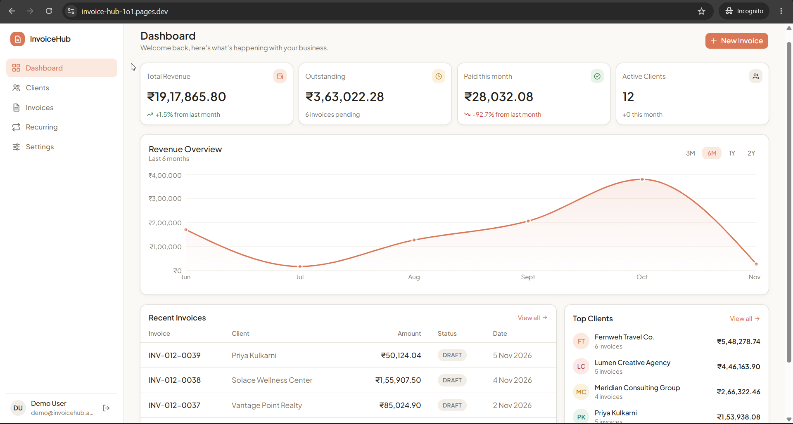
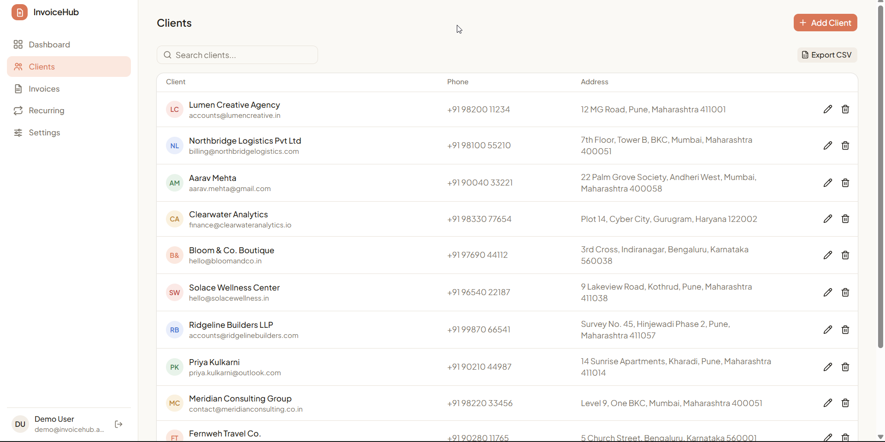
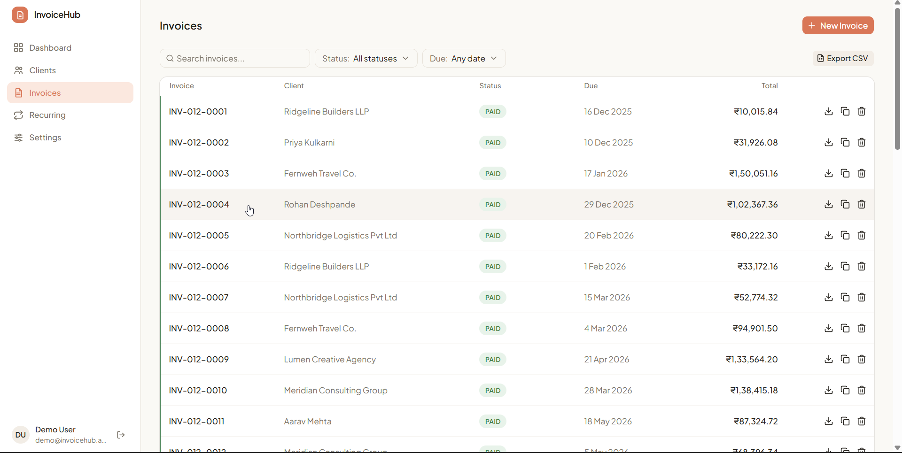
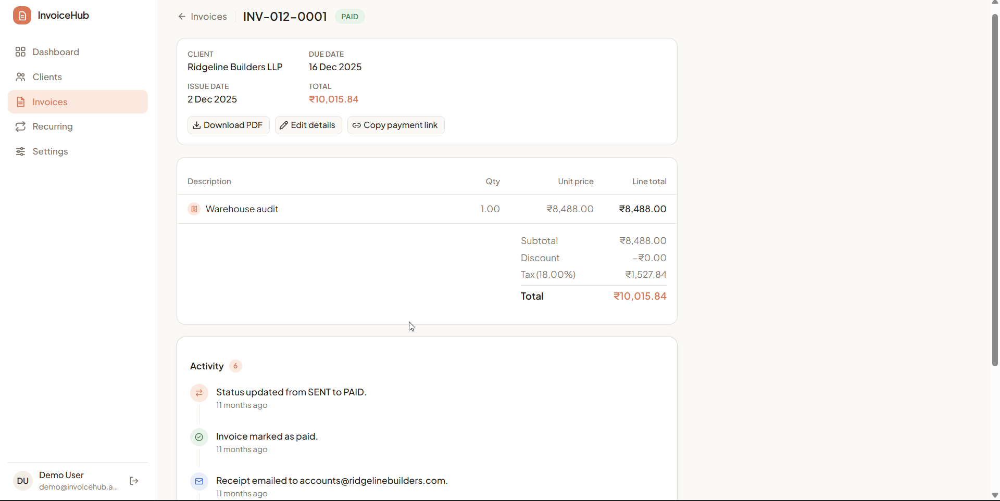
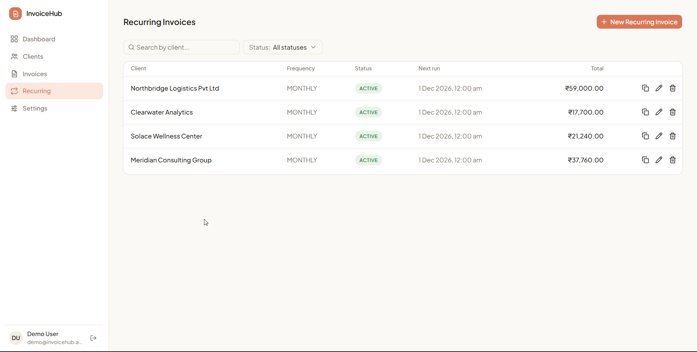
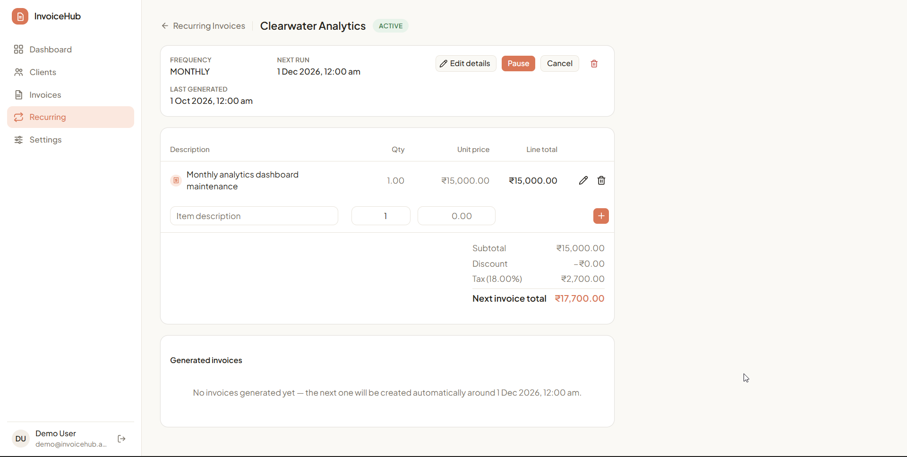
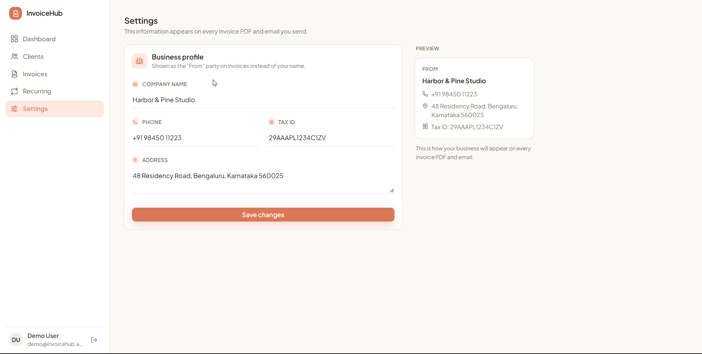

# InvoiceHub

🔗 **Live Demo:** https://invoice-hub-1o1.pages.dev

A full-stack invoicing and billing SaaS built with a headless Laravel REST API and a React frontend. Business owners manage clients and invoices, generate branded PDF invoices, collect payments online via Razorpay (including a no-login public payment link), and track revenue through a live dashboard. The backend follows a strict Controller → Service → Repository → DAO layering with Redis-backed queues for async work, scheduled jobs for recurring invoices and overdue detection, and an event-driven notification pipeline. The frontend is built with React, TanStack Query, Tailwind CSS, and shadcn/ui.

## Screenshots

| Dashboard | Client List |
|---|---|
|  |  |

| Invoice List | Invoice Detail |
|---|---|
|  |  |

| Recurring Invoices | Recurring Invoice Detail |
|---|---|
|  |  |

| Settings |
|---|
|  |

## Architecture

The backend follows a layered architecture to keep concerns cleanly separated:

```
HTTP Request
     │
     ▼
 Controller        ← validates input (FormRequest), calls Service, returns response
     │
     ▼
  Service          ← all business logic lives here
     │
     ▼
 Repository        ← interface, bound to a RepositoryImpl; plain Eloquent queries only
     │
     ▼
    DAO             ← setter-based data object passed into Repository writes
```

**Controller** — Thin layer responsible only for request validation and response formatting. No business logic.

**Service** — Owns all business rules (status transitions, totals calculation, payment verification, idempotent webhook handling). Has no knowledge of Eloquent internals beyond what the Repository hands it back.

**Repository** — An interface bound to a `RepositoryImpl` via a service provider. Contains only Eloquent queries, always returns a `Collection` (even for a single expected row) so nothing downstream touches Eloquent's magic property access directly.

**DAO (Data Access Object)** — Setter-based plain object passed into Repository write methods, decoupling the rest of the application from the raw attribute array shape.

Async work (PDF generation, outbound email) runs on a Redis-backed queue rather than the request thread, following the **Async Request-Reply** pattern: an endpoint returns immediately with a request id, and the frontend polls for the result.

## Features

* **JWT + HttpOnly Cookie Authentication:** Custom JWT service (HS256) with a `Bearer` header check and an HttpOnly cookie fallback — register/login/logout, plus a token-based forgot/reset password flow.
* **Client Management:** Full CRUD for clients, scoped per business owner.
* **Invoice Lifecycle:** Draft → Sent → Paid/Overdue/Cancelled status workflow, with line items, auto-computed totals, and a full status-change history.
* **Invoice Cloning:** Duplicate an existing invoice (line items included) as a new draft.
* **PDF Generation:** Branded PDF invoices (DomPDF) rendered off the request path on a Redis-backed queue — the frontend polls a status endpoint and fetches the result once ready.
* **Recurring Invoices:** Scheduled command generates invoices on a recurring schedule from a saved template.
* **Automatic Overdue Detection:** A daily scheduled command flips `Sent` invoices past their due date to `Overdue` and fires a reminder email, with a `Cache::lock` guard against overlapping runs.
* **Email Notifications:** Invoice-sent confirmation, overdue reminder, and payment receipt emails, each with the invoice PDF attached, dispatched via Laravel Events and Listeners so a failing email never blocks the triggering request.
* **Razorpay Payments:** Order creation, "Pay Now" checkout, and a webhook handler that verifies the Razorpay signature and applies idempotent status updates (safe against duplicate webhook delivery).
* **Public Payment Link:** A client can view and pay an invoice via a shareable, token-based URL with no login required.
* **Dashboard:** Cached KPI, revenue-over-time, and top-client aggregation endpoints, visualized with Recharts.
* **Business Profile / Branding:** Company name, address, and tax details configured once and reflected across every generated PDF and email.
* **CSV Export:** Export the currently filtered invoice or client list to CSV, entirely client-side.
* **Activity / Audit Log:** A per-invoice timeline of every lifecycle event — created, edited, sent, paid, overdue, line-item changes.

## Security

* **Password Hashing:** All passwords hashed with bcrypt — plain text is never persisted.
* **Custom JWT:** Tokens signed with HMAC-SHA256; verified on every protected request via a `Bearer` header or HttpOnly cookie.
* **User-Scoped Queries:** Every read/write is scoped to the authenticated owner's `user_id` at the repository layer, preventing cross-tenant access to another user's clients or invoices.
* **Webhook Signature Verification:** The Razorpay webhook verifies `X-Razorpay-Signature` against the raw request body before any state change, and handles idempotency as a status check rather than a separate dedup table.
* **Rate Limiting:** Login, registration, password reset, and public invoice/payment routes are throttled.
* **No User Enumeration:** The forgot-password endpoint returns an identical response whether or not the email exists.

## Built With

[](https://skillicons.dev)

## Usage

To run this project locally, follow these steps:

1. Clone the repository:

   ```bash
   git clone https://github.com/DikshaGowda007/invoice-hub.git
   cd invoice-hub
   ```

2. Set up the backend:

   ```bash
   cd backend
   composer install
   cp .env.example .env
   php artisan key:generate
   php artisan migrate
   ```

3. Configure `backend/.env`:

   ```env
   DB_DATABASE=your_database
   DB_USERNAME=your_username
   DB_PASSWORD=your_password
   QUEUE_CONNECTION=redis
   REDIS_HOST=127.0.0.1
   MAIL_MAILER=log
   RAZORPAY_KEY_ID=your_razorpay_key
   RAZORPAY_KEY_SECRET=your_razorpay_secret
   RAZORPAY_WEBHOOK_SECRET=your_webhook_secret
   FRONTEND_URL=http://localhost:5173
   ```

4. Start the backend server and queue worker (two terminals):

   ```bash
   php artisan serve
   php artisan queue:work redis
   ```

5. Set up the frontend:

   ```bash
   cd ../frontend
   npm install
   ```

6. Configure `frontend/.env`:

   ```env
   VITE_API_URL=http://localhost:8000/api/v1
   ```

7. Start the frontend:

   ```bash
   npm run dev
   ```

## What Did I Learn

* **Async Request-Reply Pattern:** Moved PDF generation off the request thread onto a Redis-backed queue, with the frontend polling for the result — the same shape cloud providers use for long-running operations.
* **Queued Jobs Have No Request Context:** A queued job can't resolve the current user from the HTTP request like a normal service can — learned to capture `$userId` explicitly at dispatch time, synchronously, before the job goes on the queue.
* **Webhook Idempotency as a Status Check:** Rather than a separate dedup table, a webhook handler can treat "already in the target state" as a safe no-op — simpler, and correct under duplicate delivery.
* **Events and Listeners for Decoupling:** A single status transition (e.g. marking an invoice paid) can fan out into independent, independently-failable side effects — a receipt email and an activity log entry — without either blocking the other.
* **Diagnosing Past the Application Layer:** A queued email with no exception thrown isn't proof it was delivered — traced a real Gmail deliverability issue down to the provider's own bounce data (sender-reputation filtering), not a code defect, by ruling out wrong theories with evidence instead of assuming.
